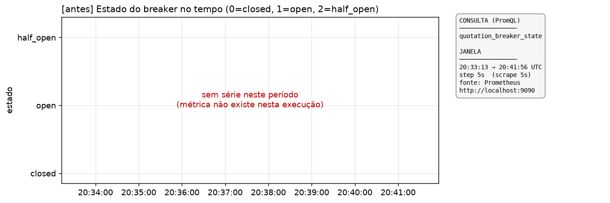
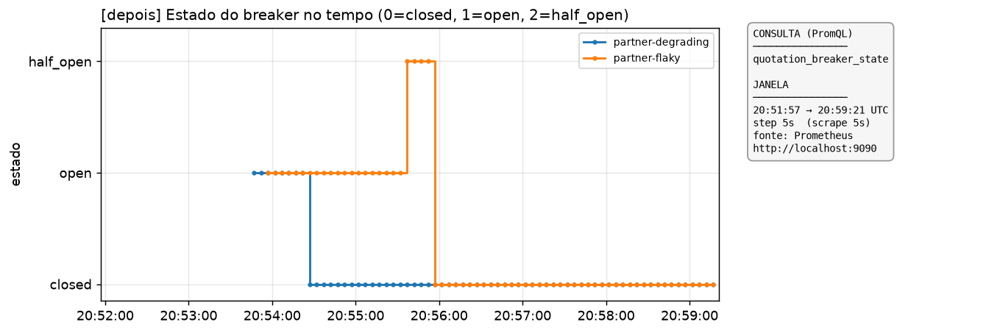
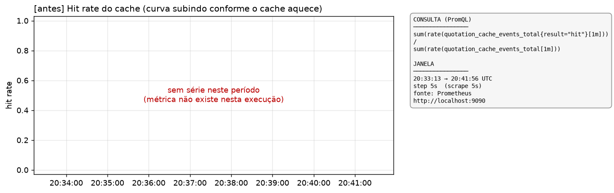
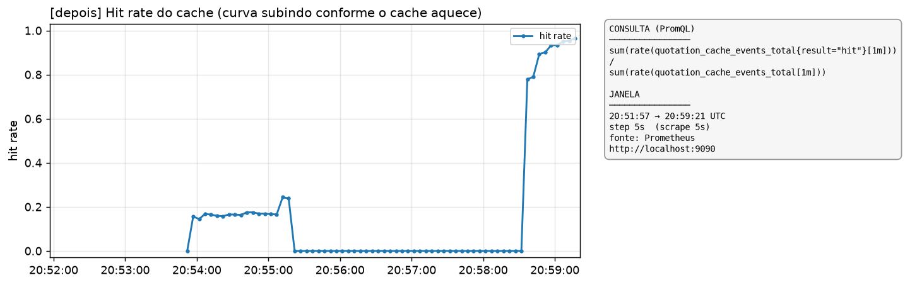
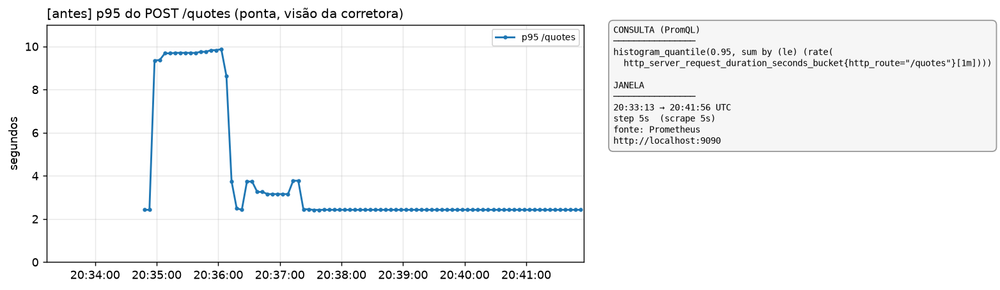
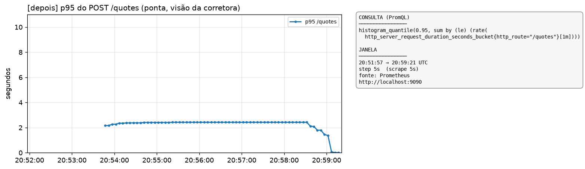

# Evidências de métrica — consultas PromQL, **gráficos** e marcações de trace

Cada gráfico do Prometheus é capturado **durante** a execução (o Prometheus retém só 1h e
`make down` zera tudo). Para cada uma das três evidências há **um PNG por execução** — "antes"
(starter sem proteção) e "depois" (com breaker + timeout + cache + fallback) — na **mesma escala de
eixo**, com a **consulta PromQL e a janela ao lado** no próprio gráfico. Fonte: API do Prometheus em
`http://localhost:9090`, `scrape_interval` de 5s (`deploy/prometheus/prometheus.yml`).

Como os gráficos foram gerados (reproduzível):

```bash
# cria o ambiente de plotagem (matplotlib) e, para cada fase, roda make down && make reproduce,
# cicla o breaker e aquece o cache, e consulta a API query_range do Prometheus gerando os PNGs.
python3.12 -m venv .venv-plot && .venv-plot/bin/pip install matplotlib requests
bash scripts/run_phase.sh depois   # HEAD   -> docs/evidencias/graficos/depois-*.png
bash scripts/run_phase.sh antes    # starter-> docs/evidencias/graficos/antes-*.png
```

> O "antes" é o código do starter (sem `internal/platform/metrics.go`): as métricas de negócio
> `quotation_breaker_state` e `quotation_cache_events_total` **não existem** naquela execução, então
> os dois gráficos correspondentes mostram, honestamente, "sem série". É a prova gráfica de que o
> breaker e o cache só passam a existir no "depois".

---

## 1. Estado do breaker no tempo (degrau fechado → aberto → meio aberto → fechado)

```promql
quotation_breaker_state
```

Legenda do valor: `0 = closed`, `1 = open`, `2 = half_open`, por parceira.

| antes (starter) | depois (HEAD) |
|---|---|
|  |  |
| métrica inexistente no starter → sem série | degrau `open → half_open → closed` das parceiras que cicleram |

No "depois", a `partner-flaky` (40% de falha) desenha o degrau completo `open → half_open → closed`;
a `partner-degrading` mostra `open → closed` porque seu `half_open` é curtíssimo (o probe rápido
fecha o breaker entre dois scrapes de 5s). O **ciclo inteiro das duas** fica provado no contador de
transições — que não depende do instante do scrape:

```promql
quotation_breaker_transitions_total
```

```
partner-degrading closed -> open       = 1
partner-degrading open   -> half_open  = 1
partner-degrading half_open -> closed  = 1
partner-flaky     closed -> open       = 1
partner-flaky     open   -> half_open  = 2
partner-flaky     half_open -> closed  = 1
partner-flaky     half_open -> open    = 1   (flapping: a parceira de 40% nem morre nem recupera de vez)
```

> Nota de amostragem: o `quotation_breaker_state` é um *observable gauge* lido a cada scrape (5s) e só
> começa a emitir depois da 1ª transição de cada parceira; por isso a série começa em `open` e o
> `half_open`, por ser transitório, pode não cair em um scrape. O **degrau** é a leitura do gauge; a
> **prova do ciclo completo** é o contador de transições acima.

## 2. Hit rate do cache (a curva subindo conforme o cache aquece)

```promql
sum(rate(quotation_cache_events_total{result="hit"}[1m]))
/
sum(rate(quotation_cache_events_total[1m]))
```

| antes (starter) | depois (HEAD) |
|---|---|
|  |  |
| cache inexistente no starter → sem série | sobe de 0 a **≈ 0,95** conforme o cache aquece |

A curva do "depois" sobe para ~0,95 à medida que as cotações repetidas passam a ser servidas de
cache (no gráfico, o patamar baixo inicial é a fase de cotações distintas que forçam o breaker —
muitos *miss*; depois a fase de cotações repetidas puxa o hit rate para perto de 1). O isolamento
por corretora continua provado pelo acumulado por `tenant_id`:

```promql
quotation_cache_events_total
```

> O hit rate deste gráfico é propriedade da carga, não de produção. O número que sustenta a planilha
> da seção 8 do SAD sai do pressuposto de recotação, não daqui.

## 3. p95 do POST /quotes (ponta, visão da corretora) — a evidência que faltava

```promql
histogram_quantile(0.95, sum by (le) (rate(
  http_server_request_duration_seconds_bucket{http_route="/quotes"}[1m])))
```

Esta é a métrica genérica de borda HTTP (reaproveitada, como permitido) e **existe nas duas
execuções** — por isso o "antes" agora tem gráfico em vez de um traço na tabela.

| antes (starter) | depois (HEAD) |
|---|---|
|  |  |
| pico **≈ 9,9 s** sob carga (agregação em série, sem timeout) | teto **≈ 2,4 s** (efeito do timeout de 2 s) e queda com cache |

Os dois gráficos usam a **mesma escala de eixo Y (0–11 s)**, então a diferença de altura é direta: a
plataforma sem proteção afunda perto de 10 s sob a carga; a protegida fica presa no teto do timeout
(~2,4 s) e cai para milissegundos quando o cache passa a servir. Isso casa com os relatórios de
carga (`antes-reproduce.txt` = p95 8,01 s; `depois-reproduce.txt` = p95 2,01 s), medidos pelo
loadgen na janela da carga padrão.

## 4. Latência por parceira (significado de domínio)

```promql
histogram_quantile(0.95, sum by (partner, le) (rate(quotation_partner_request_duration_seconds_bucket[1m])))
```

Só existe no "depois" (é uma métrica de negócio). As três parceiras batem no teto do **timeout de
2 s** sob concorrência — exatamente o *ceiling* que fez a `partner-degrading` parar de afundar sem
limite. Contagem por resultado:

```promql
quotation_partner_request_duration_seconds_count
```

## Marcações de trace (Jaeger)

Export JSON em `docs/evidencias/`:

- **`trace-short-circuited.json`** — requisição com o breaker aberto. As parceiras curto-circuitadas
  **não têm span de saída** e o trace carrega os eventos `breaker.short_circuited`. Aberto = não chama.
- **`trace-cache-served.json`** — resposta servida de cache: **só o span de servidor** `POST /quotes`,
  nenhum span de parceira, e o evento `cache.served` (`stale=false`).

Janela no Jaeger: `Last Hour`, serviço `quotation-api`, operação `POST /quotes`.
