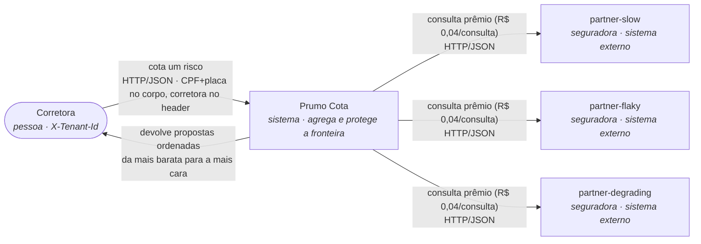
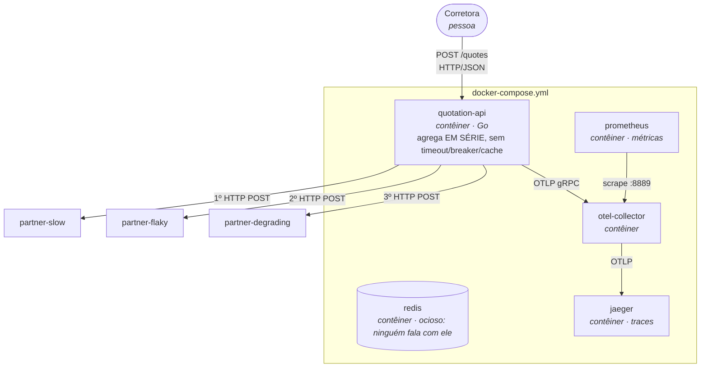
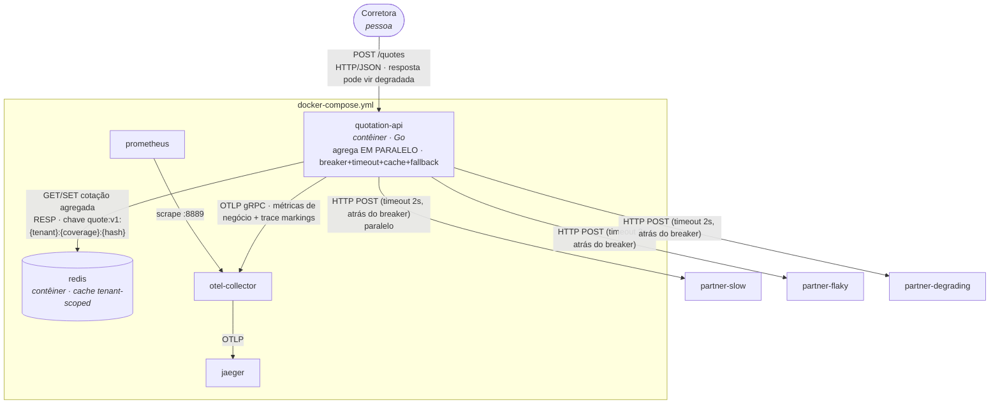
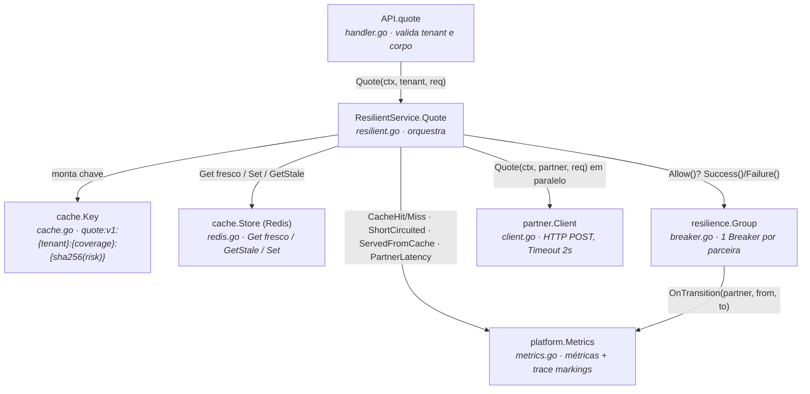

# SAD — Prumo Cota, plataforma de cotação de seguro auto (depois da intervenção)

> Documento de arquitetura da plataforma **depois** da intervenção de resiliência. O PoC em código
> implementa a fatia aqui defendida; onde o documento propõe mais do que o PoC entrega, isso está
> marcado como **proposta**. Todo caminho citado existe no repositório.

## 1. Introdução

### Propósito e leitores

Este SAD decide e justifica como a **Prumo Cota** deixa de ter sua disponibilidade igual ao *produto*
da disponibilidade das três seguradoras parceiras. Ele serve a três leitores: o **CTO**, que aprova o
gasto (seção 8); quem **opera** às 3h da manhã (seções 6 e 7); e o **encarregado de dados e
auditoria**, que responde à ANPD e à SUSEP (seções 4, 5, 7).

### Escopo

Cobre a plataforma de cotação (`quotation-api`) e a sua **fronteira** com as seguradoras
(`internal/partner/client.go`, `internal/quotation/`). **Não** redesenha os motores de precificação
das parceiras (são mocks e continuam mocks), o CRM da corretora, cobrança, nem UI.

### Restrições (impostas, não escolhidas)

| Restrição | Origem |
|---|---|
| Go 1.25, Docker Compose v2, Redis como cache, OpenTelemetry, Mermaid | enunciado (`docs/enunciado.md`) |
| Três parceiras instáveis, perfis fixos no `docker-compose.yml` | cenário; `cmd/partner-mock/` não se altera |
| Cada consulta a uma parceira custa R$ 0,04; 3 por cotação; 120.000 cotações/dia útil | cenário |
| Corretora no cabeçalho `X-Tenant-Id`; CPF e placa no corpo, sob LGPD (operadora) | contrato e `internal/quotation/handler.go` |
| Cotação apresentada é auditável por 5 anos (SUSEP), inclusive servida de cache | cenário |
| Teto comercial de reaproveitamento de cotação: 24 horas | cenário |

### Decisões (minhas, defendidas adiante)

Timeout por parceira = **2 s**; breaker per-parceira que abre em **5 falhas consecutivas**, cooldown
de **30 s**, fecha com **2 sucessos** no meio-aberto; cache agregado tenant-scoped com TTL de
**300 s** e janela de stale de **24 h**; fallback por **resposta parcial + cache vencido marcado**;
hospedagem **híbrida** (seção 5). Cada número é justificado na seção 4.

### Pressupostos (valor, origem, consequência se falso)

- **PS-01 — Recotação: 60% das cotações se repetem dentro da janela de TTL (5 min).** Origem: o
  cenário afirma que "o corretor recota a mesma placa várias vezes na mesma conversa e o cliente pede
  a mesma cotação em mais de uma corretora". **Se for 20%**, o hit rate real cai para ~0,2, a economia
  da seção 8 encolhe de R$ ~190 mil/mês para R$ ~63 mil/mês, e o payback do cache (que já é imediato,
  pois o Redis custa pouco) continua positivo mas a tese de "metade da conta de parceiro some" cai.
- **PS-02 — A rajada determinística de 9 falhas da `partner-flaky` (sequências 49–57) ocorre em toda
  execução a partir do ambiente zerado.** Origem: `docs/smoke-test-factibilidade.md`, travado por
  `cmd/partner-mock/feasibility_test.go`. **Se falso** (mudança de semente), o breaker de 5 falhas
  consecutivas poderia não abrir dentro de um `make reproduce`, e a evidência do degrau precisaria de
  carga maior.
- **PS-03 — O timeout de 2 s é maior que o p95 saudável da parceira mais lenta (`partner-slow`,
  1500 ms ± 200 ms ⇒ ~1,7 s) e menor que o teto de afundamento da `partner-degrading` (6 s).** Origem:
  perfis no `docker-compose.yml`. **Se falso** (timeout < 1,7 s), a `partner-slow` saudável seria
  cortada e contada como falha, abrindo o breaker dela sem necessidade e derrubando uma fonte de
  cotação que funciona.

## 2. Visão geral da arquitetura

### Nível 1 — Contexto (a Prumo intermedeia, não precifica)



### Nível 2 — Contêiner, ANTES (tudo-ou-nada, em série, sem proteção)



Delta do antes: latência = **soma** das três (p95 medido 8,01 s sob carga, ver seção 3); qualquer 503
da `partner-flaky` vira 502 e descarta o que já chegou; Redis ocioso.

### Nível 2 — Contêiner, DEPOIS (fronteira protegida)



**Delta (o que muda):**

- **+** `internal/resilience/` — breaker per-parceira com timeout (novo pacote);
- **+** `internal/cache/` — cache tenant-scoped sobre o Redis que já subia (novo pacote);
- **+** `internal/quotation/resilient.go` — agregação paralela + fallback + contrato `Response`
  estendido (`Degraded`);
- **+** `internal/platform/metrics.go` — 3 métricas de negócio + 2 marcações de trace;
- **Δ** `cmd/quotation-api/main.go` liga tudo; `docker-compose.yml` ganha `REDIS_ADDR`;
- **=** `cmd/partner-mock/`, `cmd/loadgen/`, `internal/platform/telemetry.go` intactos.

A quem serve: a corretora passa a receber **uma cotação sempre** (completa, parcial ou de cache
marcado), e a Prumo deixa de comprar a consulta da parceira que o breaker cortou.

## 3. Requisitos

### Funcionais

| ID | Requisito (frase testável) | Origem |
|---|---|---|
| RF-01 | `POST /quotes` exige `X-Tenant-Id`; sem ele responde 400 `X-Tenant-Id is required`. | contrato (`handler.go`) |
| RF-02 | Corretora fora de `TENANTS` recebe 403 `broker not enabled on this platform`. | `handler.go` |
| RF-03 | A resposta agrega as parceiras disponíveis, **ordenadas por prêmio crescente**, mesmo degradada. | `resilient.go` (`sortByPremium`) |
| RF-04 | Toda cotação apresentada é rastreável até a parceira ou até a entrada de cache que a originou; nenhum prêmio é calculado pela plataforma. | cenário; `resilient.go` nunca fabrica `Quote` |
| RF-05 *(novo)* | Quando uma parceira está indisponível (falha ou breaker aberto), a resposta é **parcial e marcada** (`degraded.source="partial"`, `degraded.missing=[...]`) em vez de 502. | `resilient.go`, `request.go` |
| RF-06 *(novo)* | Sem resposta viva de nenhuma parceira, serve-se a **cotação anterior do cache marcada com a idade** (`degraded.source="cache"`, `degraded.age_seconds`); só na ausência dela a requisição falha com 502. | `resilient.go` (`GetStale`) |

### Não funcionais

| ID | Requisito | Métrica | Hoje (medido por mim) | Alvo | Como medir | Por que este alvo |
|---|---|---|---|---|---|---|
| RNF-01 | Latência da cotação sob carga | p95 `POST /quotes` | **8,01 s** (`docs/evidencias/antes-reproduce.txt`) | ≤ 2,5 s | `http_server_request_duration_seconds` | O corretor está com o cliente na frente; acima de ~3 s ele abandona. 2,5 s ≈ 2 s de timeout + overhead. **Medido depois: 2,01 s** (`depois-reproduce.txt`). |
| RNF-02 | Disponibilidade da cotação (taxa de sucesso) sob carga | sucesso/total | **60%** (antes) | ≥ 99% | relatório do `make reproduce` | Uma parceira de 40% de falha não pode derrubar a cotação. **Medido depois: 100%.** |
| RNF-03 | Economia de consultas via cache | hit rate | **0%** (não havia cache) | ≥ 60% no pressuposto PS-01 | `quotation_cache_events_total` | É a variável financeira da seção 8. Na carga sintética chega a ~78%; em produção, PS-01. |
| RNF-04 | Corte de parceira doente | breaker abre dentro de uma execução | **nunca abre** (antes) | abre ≤ req. 53 na rajada 49–57 | `quotation_breaker_transitions_total` | A rajada determinística garante o corte cedo. **Medido: abre e cicla** (`promql.md`). |
| RNF-05 | Isolamento de dados por corretora | chave de cache contém `tenant_id` | **n/a** (sem cache) | 100% das chaves | inspeção de `cache.Key` + teste `TestKeyIsolatesTenants` | LGPD: devolver a A o que B cotou é incidente com dever de notificação à ANPD. |

Três linhas têm a coluna "hoje" medida por mim: RNF-01, RNF-02, RNF-03 (as duas primeiras do relatório
antes/depois, a terceira pela ausência de cache).

## 4. Detalhamento da arquitetura

### Nível 3 — Componente (a fatia implementada)



### Decisão 1 — Circuit breaker (contexto → opções → escolha → consequências)

**Contexto.** A `partner-flaky` falha 40%; a `partner-degrading` afunda até 6 s sob concorrência.
Sem corte, a plataforma acumula chamadas caras e lentas.

**Opções.** (a) breaker **global** único; (b) breaker por **par (parceira, corretora)**; (c) breaker
**por parceira**.

**Escolha: (c) por parceira** (`resilience.Group`, uma instância de `Breaker` por `partner.Name`).
Parâmetros, todos em `platform.Resilience` e em `cmd/quotation-api/main.go`:

| Parâmetro | Valor | Defesa |
|---|---|---|
| `PARTNER_TIMEOUT` | **2 s** | > p95 saudável da `partner-slow` (~1,7 s, PS-03) e < teto de 6 s da `partner-degrading`. O estouro **conta como falha** (`client.go` → `*partner.Error` → `breaker.Failure()`): é o que faz a parceira lenta virar sinal para o contador, já que ela nunca retorna erro. |
| `BREAKER_FAILURES_TO_OPEN` | **5 falhas consecutivas** | A rajada determinística tem 9 falhas (49–57); 5 abre por volta da seq. 53, dentro de um `make reproduce`, sem abrir à toa em falha isolada. Confirmado em `internal/resilience/breaker_test.go` e `cmd/partner-mock/feasibility_test.go` (política "5 consecutivas"). |
| `BREAKER_OPEN_COOLDOWN` | **30 s** | Tempo para a parceira respirar antes de uma sonda. Curto o bastante para recuperar rápido quando a causa passa, longo o bastante para não martelar. |
| `BREAKER_HALF_OPEN_SUCCESSES` | **2 sucessos** | Evita fechar no primeiro acerto sortudo de uma parceira ainda instável. |

**Aberto = não chama.** `Breaker.Allow()` retorna `false` quando aberto, e `callOne`
(`resilient.go`) nem invoca o cliente; emite `ShortCircuited` no trace. Prova:
`docs/evidencias/trace-short-circuited.json` tem só o span de saída da parceira chamada; as
curto-circuitadas não têm span.

**Consequências ruins.** O breaker **vive na memória do processo** (ver LIM-02). O meio-aberto deixa
passar **uma** sonda; sob rajada ela pode falhar e reabrir (flapping), que é o comportamento esperado
de uma parceira de 40% — visível no ciclo medido em `promql.md`.

### Decisão 2 — Cache (contexto → opções → escolha → consequências)

**Contexto.** Metade da receita sai pela consulta de R$ 0,04, e muita consulta é repetida.

**Opções.** (a) cache **por parceira**; (b) cache da **cotação agregada**; (c) **sem cache**.

**Escolha: (b) cotação agregada tenant-scoped.** Economiza as três consultas de uma vez quando a
cotação inteira é reaproveitada, que é o caso dominante do cenário (recotação da mesma placa).

**Chave, por extenso** (`cache.Key`, em `internal/cache/cache.go`):

```
quote:v1:{tenant}:{coverage}:{sha256(document|birth_year|plate|model|year|value_cents|coverage)}
```

O `tenant` é prefixo **legível e obrigatório** (isolamento LGPD, RNF-05, travado por
`TestKeyIsolatesTenants`); o risco é **hasheado** para que CPF e placa nunca entrem na chave
(`TestKeyDoesNotLeakPersonalData`).

**Política.** TTL = **300 s** (`CACHE_TTL`), amarrado ao `valid_for_seconds=300` que as parceiras
devolvem e **muito abaixo** do teto comercial de 24 h — uma cotação de mais de 5 min já tem risco de
estar vencida no motor da seguradora. Janela de **stale = 24 h** (`CACHE_STALE_FOR`): quando o breaker
abre e não há resposta viva, a cotação vencida ainda é servida como fallback, **marcada**
(`degraded.source="cache"`, com `age_seconds`), até o teto de 24 h. Expiração da chave no Redis =
`StaleFor`, para que o dado pessoal seja descartado sozinho (LGPD). Invalidação antes da hora: hoje é
só o TTL (ver LIM-03).

**Consequências ruins.** Duas requisições concorrentes da mesma corretora/placa, uma de cache e outra
de parceira, podem devolver prêmios diferentes para o mesmo risco no mesmo minuto (citado, fora de
escopo). Cache agregado perde a cotação inteira se a chave muda por um campo irrelevante — mitigado
pela normalização (`TestKeyIsStableUnderCasingAndSpacing`).

### Decisão 3 — Fallback (contexto → opções → escolha → consequências)

**Contexto.** Hoje uma parceira fora vira 502 e descarta o que já chegou.

**Opções.** (a) **resposta parcial**; (b) **cotação anterior de cache**; (c) **recusa explícita**.

**Escolha: (a) + (b) combinadas**, nesta ordem (`resilient.go`): se alguma parceira respondeu, serve
**parcial** com `missing`; se nenhuma respondeu mas há cache dentro da janela stale, serve a
**cotação anterior** marcada com a idade; só então 502. O contrato muda em
`internal/quotation/request.go` com o campo opcional `degraded` (`Degraded{Source, Missing,
AgeSeconds}`) — ausente na resposta normal, presente e explícito na degradada.

**Consequências ruins.** A corretora pode receber 2 de 3 prêmios e fechar no mais barato dos dois sem
saber que o terceiro seria menor — por isso `missing` é explícito. Recusa (c) foi descartada: o
produto admite proposta incompleta marcada, e recusar jogaria fora cotações boas já pagas.

### Quatro limites conhecidos que esta entrega NÃO resolve

| ID | Limite | Gatilho que o expõe | Efeito na corretora |
|---|---|---|---|
| LIM-01 | **Sem limite de chamadas simultâneas por parceira.** O breaker corta por falha/lentidão, não por concorrência. | Pico de carga antes de o timeout/breaker reagirem; a `partner-degrading` recebe muitas chamadas simultâneas. | Latência sobe até o timeout de 2 s antes de o breaker abrir; algumas cotações demoram 2 s. |
| LIM-02 | **O breaker vive na memória do processo**, não atravessa réplicas. | Escalar a `quotation-api` para N réplicas. | Cada réplica reaprende sozinha que a parceira caiu; a parceira leva até N× mais chamadas falhas antes de o corte valer para todas. |
| LIM-03 | **TTL é a única invalidação do cache.** Não há invalidação por evento. | A seguradora muda a tabela de preço dentro da janela de 300 s. | A corretora vê um prêmio desatualizado por até 5 min (ou até 24 h, se servido como stale). |
| LIM-04 | **Uma corretora pode consumir a capacidade das outras.** Não há bulkhead/quota por tenant. | Uma corretora dispara um volume anômalo. | As demais corretoras competem pela mesma pool e veem latência maior. |

Nenhum é para implementar (retry, bulkhead, rate limiting e fila estão fora de escopo). São a fronteira
declarada da arquitetura.

## 5. Implementação

### Como se constrói — mecanismo → arquivo real

| Mecanismo | Arquivo | Biblioteca | Teste determinístico |
|---|---|---|---|
| Circuit breaker + estados | `internal/resilience/breaker.go` | **própria** (≈210 linhas) | `internal/resilience/breaker_test.go` (relógio falso, rajada 49–57) |
| Timeout por parceira | `internal/partner/client.go` (`WithTimeout`) | stdlib `net/http` | `internal/partner/client_test.go` (`TestQuoteTimesOut`) |
| Cache tenant-scoped | `internal/cache/{cache,redis}.go` | `github.com/redis/go-redis/v9 v9.7.3` | `internal/cache/cache_test.go` (isolamento, sem PII, janelas TTL/stale) |
| Agregação paralela + fallback | `internal/quotation/resilient.go` | stdlib `sync` | `internal/quotation/resilient_test.go` (parcial, cache, stale, breaker aberto) |
| Métricas + trace markings | `internal/platform/metrics.go` | OTel (SDK já inicializado em `telemetry.go`) | `internal/platform/metrics_test.go` (reader manual + span recorder) |

**Por que um breaker próprio e não `gobreaker`.** O enunciado deixa a escolha livre e exige que os
**três estados sejam visíveis de fora** e que **aberto não chame a parceira**. Um breaker próprio de
~210 linhas expõe exatamente `State()`, `Allow()`, `Success()`, `Failure()` e um `OnTransition`
hook — a superfície mínima que a instrumentação precisa, sem puxar uma dependência cuja API eu teria
de adaptar ao hook de métrica. A alternativa `gobreaker` foi descartada por isso: economizaria código,
mas o custo de encaixar o `OnStateChange` dela no meu observador e garantir a semântica de "half-open
deixa passar exatamente uma sonda" anularia o ganho.

**O comportamento se testa sem sorte:** relógio injetável (`Settings.Now`) e a sequência de falhas
documentada, no padrão de `cmd/partner-mock/feasibility_test.go`. Nenhum `sleep`.

### Onde roda — hospedagem (Decisão 4: contexto → opções → escolha → consequências)

**Contexto.** SUSEP exige auditoria de 5 anos não regravável; LGPD exige residência e segregação do
dado pessoal (CPF, placa), com a Prumo como operadora.

**Opções.** (a) **cloud pública** inteira; (b) **on-premise** inteira; (c) **híbrida**.

**Escolha: (c) híbrida.** O plano de dados sensível e o acervo de auditoria WORM (*write once, read
many*) ficam em infraestrutura sob contrato de residência (on-premise ou região dedicada com
object-lock); o plano de cálculo sem estado (`quotation-api`, Redis efêmero, stack de observabilidade)
roda em cloud pública, elástico e barato. A cloud pura (a) foi descartada porque joga o acervo de
auditoria para um provedor sem o controle de residência que o compliance exige; o on-premise puro (b)
foi descartado por custo e por engessar a elasticidade do plano de cálculo. Custo reaparece na seção 8.

## 6. Operação e gestão de mudanças

### O que se olha, com que limiar, qual ação (3 alertas)

| Alerta | Métrica (PromQL) | Limiar | Ação |
|---|---|---|---|
| AL-01 breaker preso aberto | `max_over_time(quotation_breaker_state{partner="X"}[10m]) == 1` | aberto por 10 min | Abrir runbook RB-01; checar `/config` e status da parceira; acionar a seguradora se persistir. |
| AL-02 hit rate despencou | `sum(rate(quotation_cache_events_total{result="hit"}[10m])) / sum(rate(quotation_cache_events_total[10m])) < 0.3` | < 30% por 15 min | Verificar saúde do Redis; se caiu, confirmar que a API está no caminho sem cache (degradado) e dimensionar o impacto de custo (seção 8). |
| AL-03 p95 da ponta alto | `histogram_quantile(0.95, sum by (le) (rate(http_server_request_duration_seconds_bucket{http_route="/quotes"}[5m]))) > 2.5` | > 2,5 s por 10 min | Checar LIM-01 (concorrência na `partner-degrading`); confirmar timeout de 2 s ativo; considerar reduzir concorrência de entrada. |

### Runbook RB-01 — "o breaker da `partner-degrading` está aberto há dez minutos"

1. **Sintoma:** AL-01 disparou para `partner-degrading`.
2. **Confirmar:** `quotation_breaker_state{partner="partner-degrading"}` = 1; conferir
   `quotation_breaker_transitions_total` para ver se está flapping ou preso.
3. **Diagnóstico rápido:** a plataforma **está servindo** cotações (parcial sem a `partner-degrading`,
   ou de cache) — confirmar pela taxa de sucesso da ponta. Se a taxa está alta, **não há incêndio**: o
   fallback está fazendo o trabalho.
4. **O que NÃO fazer:** não baixar o `BREAKER_OPEN_COOLDOWN` no susto (reabre o martelo na parceira);
   não desligar o breaker (volta o cenário "antes").
5. **Ação:** verificar `curl partner-degrading/config` e a saúde da seguradora; se a lentidão for real
   e prolongada, comunicar as corretoras de que aquela seguradora sai temporariamente das cotações.
6. **Escalonamento:** se após 30 min a parceira não normalizar e o impacto comercial (cotações sem
   aquela seguradora) for relevante, escalar para o gestor de parceria com a seguradora.

### Gestão de mudança do TTL (parâmetro de negócio)

O `CACHE_TTL` mexe em **risco de preço vencido** e em **custo**. Quem aprova mudá-lo: produto +
compliance (não é decisão só de engenharia). Caminho: alterar `CACHE_TTL` no `docker-compose.yml`/env,
redeploy; reverter é restaurar o valor e redeploy (o Redis é efêmero, então entradas com TTL antigo
somem sozinhas). Medir se melhorou: comparar hit rate (`quotation_cache_events_total`) e reclamações de
prêmio vencido antes/depois.

## 7. Recuperação de desastres

RTO/RPO **por classe de dado** (elas não valem o mesmo):

| Classe de dado | Onde vive | RPO | RTO | Justificativa |
|---|---|---|---|---|
| Cache de cotação | Redis efêmero | **∞ aceitável** (pode perder tudo) | ~segundos (recria sozinho) | Perder o cache custa dinheiro e latência, não correção. |
| Registro de auditoria | acervo WORM (seção 5) | **0** (não pode perder) | ≤ 4 h | Perda é infração regulatória (SUSEP); exige durabilidade e imutabilidade. |
| Configuração/infra | IaC versionado | último commit | ≤ 1 h | Reconstruível do repositório. |

### Cenário (a) — o Redis inteiro se perde

A corretora **não vê erro**: a API degrada para o caminho sem cache (`buildCache` cai para
`cache.Noop` quando o `Ping` falha, em `cmd/quotation-api/main.go`). O que **degrada**: o hit rate vai
a 0, e **100% das consultas voltam a ser compradas** (seção 8, linha "hoje"). O que **não para**: a
cotação continua sendo servida. Mas há um segundo efeito, mais perigoso que o custo: as mesmas
consultas voltam a ser **feitas ao mesmo tempo**, e o volume que chega às parceiras mais que dobra a
partir de 50% de hit rate; a `partner-degrading` afunda acima de 5 simultâneas até 6 s. **O colapso da
parceira chega antes da conta de custo** — em minutos, a latência; a fatura, só no fim do mês. O que a
corretora vê enquanto isso: cotações mais lentas e mais respostas parciais (a `partner-degrading`
saindo por breaker). Caminho de volta: subir o Redis; o cache reaquece sozinho em uma janela de TTL
(5 min). Custo do modo degradado: até ~R$ 14,4 mil/dia (a conta inteira de parceiro sem cache).

### Cenário (b) — uma parceira fora por seis horas

A corretora vê **respostas parciais** sem aquela seguradora (`degraded.source="partial"`,
`missing=[parceira]`), marcadas. O breaker daquela parceira fica aberto, sondando a cada 30 s. O que
para: nada; o que degrada: menos opções de prêmio. Custo: R$ 0 extra (a consulta cortada não é
comprada — economia, inclusive). Caminho de volta: o meio-aberto fecha o breaker sozinho com 2 sucessos
quando a parceira volta.

### Cenário (c) — perda do site ou da região

O plano de cálculo (cloud) sobe em outra região a partir do IaC (RTO ≤ 1 h); o acervo de auditoria WORM
replicado na infraestrutura de residência garante RPO 0 para o dado regulatório. Enquanto a região não
volta, a cotação **para** se não houver região secundária ativa (proposta: ativar-passivo é trabalho
futuro, LIM fora de escopo). O que a corretora vê: indisponibilidade da plataforma até o failover; o
dado de auditoria, intacto.

## 8. Tecnologias, custos e pessoal (TCO)

Partida (cenário): R$ 0,04/consulta, 3 consultas/cotação, **120.000 cotações/dia útil**, 22 dias
úteis ⇒ 360.000 consultas/dia, **R$ 14.400/dia**, **≈ R$ 316.800/mês**; receita R$ 0,25/cotação ⇒
R$ 30.000/dia ⇒ **R$ 660.000/mês**.

### Conta de parceiro por hit rate

Consultas compradas/mês = 360.000 × 22 × (1 − hit). Base sem cache = 7.920.000 consultas/mês.

| Cenário | Hit rate | Consultas compradas/mês | Custo/mês | Economia vs hoje | % da receita |
|---|---|---|---|---|---|
| Hoje (sem cache) | 0% | 7.920.000 | **R$ 316.800** | — | 48,0% |
| Cache, pressuposto PS-01 | 60% | 3.168.000 | **R$ 126.720** | **R$ 190.080** | 19,2% |
| Cache, conservador | 40% | 4.752.000 | **R$ 190.080** | **R$ 126.720** | 28,8% |

O hit rate da planilha (60%) é o do **pressuposto de recotação PS-01**, não o ~78% medido na carga
sintética (que repete só 5 cotações) — coerência exigida entre seções 1, 4 e 8.

### Infraestrutura acrescentada

| Item | Dimensionamento | Custo/mês (ordem) |
|---|---|---|
| Redis (cache) | 1 instância gerenciada pequena (o acervo cabe em < 1 GB: ~chaves ativas × ~1 KB) | ~R$ 300 |
| Retenção de traces/métricas | amostragem + 15 dias de métricas, traces curtos | ~R$ 500 |
| Acervo de auditoria (WORM) | ver abaixo | cresce todo mês |

**Auditoria — por cotação APRESENTADA, não por consulta comprada.** O cache derruba a consulta, **não**
o registro: cotação de cache ainda é cotação apresentada. Volume = 120.000 cotações/dia × 22 =
**2,64 milhões de cotações/mês**, independente do hit rate. A ~2 KB/registro WORM:

| | Volume acumulado | Armazenamento |
|---|---|---|
| **Ano 1** | ~31,7 milhões de cotações | ~63 GB |
| **Ano 5** | ~158 milhões de cotações | ~317 GB (todos os 5 anos guardados juntos) |

Quem dimensionar o acervo pelas **consultas que sobraram** erra para baixo pelo inverso do hit rate
(com 60%, 2,5×). O custo de armazenamento WORM no ano 5 (~317 GB + imutabilidade) fica na ordem de
poucas centenas de reais/mês — barato perto da economia de parceiro, mas obrigatório.

### Pessoal

- **Construção (PoC → produção):** 1 engenheiro backend sênior por ~3 semanas (o PoC é pequeno; o
  resto é hardening de LIM-01/02 e o failover da seção 7). Ordem: ~R$ 30–40 mil one-off.
- **Operação:** a plataforma entra no rodízio de plantão existente; os 3 alertas e o runbook da seção 6
  são o custo operacional novo. ~0,2 FTE de SRE. Ordem: ~R$ 6 mil/mês.

### Veredito

O cache **se paga imediatamente**: economia de R$ 126–190 mil/mês de consulta de parceiro contra
infra+pessoal nova na ordem de R$ 7 mil/mês. Payback < 1 mês. Mesmo no pior pressuposto (PS-01 falso,
hit rate 20%), a economia (~R$ 63 mil/mês) cobre a nova operação com folga. A decisão de construir o
cache, o breaker e o fallback **passa no teste financeiro** — e, diferente do "antes", a plataforma
deixa de prometer uma disponibilidade que é o produto de três fornecedores que ela não controla.
